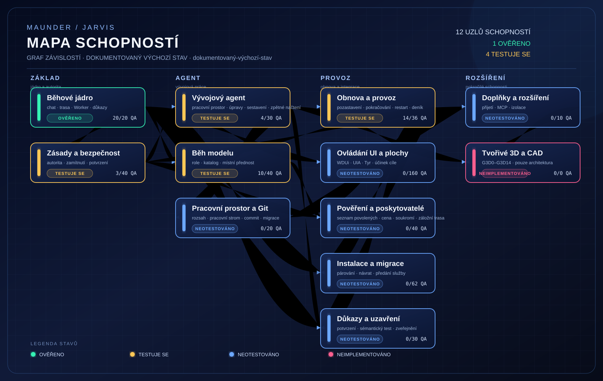

# Project codename: Jarvis

**Language:** [Čeština (default)](README.md) · **English fallback**

<p><a href="README.md">🇨🇿 <strong>Otevřít český README</strong></a></p>

**Jarvis is an internal project codename, not the final product name.**

The target is a free **Personal 1.0.0** edition. When it is ready for public
release, it will be published under a different product name.

There is currently no public installer available. Earlier development and beta
builds were removed from the download channel because they did not meet the
target quality and scope for version 1.0.0.

## Feedback

Jarvis is a publicly tracked development project:

- [🐞 Report a bug](https://github.com/jeniksoft/app-downloads/issues/new?template=bug_report.yml)
- [💡 Suggest an improvement](https://github.com/jeniksoft/app-downloads/issues/new?template=feature_request.yml)
- [💬 Start a discussion](https://github.com/jeniksoft/app-downloads/discussions)

Do not post passwords, tokens, personal data or complete private logs. Attach
only cleaned and necessary information.

## Age restriction (18+)

Jarvis is intended exclusively for adults aged 18 and over. If you are under
18, do not use Jarvis.

<!-- JARVIS_IMPLEMENTATION_PROGRESS_BEGIN -->
## Jarvis Personal: implementation roadmap status

**796 / 951 = 83.70% with implementation evidence**

Implementation evidence counts `verified`, `implemented-unverified` and
`release-ready` slices. `implemented-unverified` is not verification or release
acceptance. Retired weighted progress views are not displayed here.

| Roadmap group | With implementation evidence / total |
| --- | ---: |
| Platform foundations | 55 / 55 |
| Runtime core | 64 / 64 |
| Personal 1.0.0 | 144 / 149 |
| Optional tracks | 138 / 166 |
| Teams | 70 / 70 |
| Enterprise | 63 / 63 |
| Cross-cutting capability tracks | 262 / 384 |

Status: 499 verified, 297 implemented-unverified, 0 release-ready,
4 in-progress, 149 architecture-only, 2 deferred.

This number is **not** production readiness, live QA or release acceptance.
The [detailed snapshot](progress.json) may contain older QA fields using a
different methodology.
<!-- JARVIS_IMPLEMENTATION_PROGRESS_END -->

<!-- JARVIS_CAPABILITY_MAP_BEGIN -->
## Capability constellation



This is a dependency graph of capabilities, not a list of scenario ranges.
Each node shows implementation state, QA state and associated scenario
coverage; arrows point from prerequisites to dependent capabilities.

**Snapshot:** documented baseline · source revision `documented-basel` ·
12 capability nodes

| State | Nodes |
| --- | ---: |
| Tested | 1 |
| Testing | 4 |
| Not Tested | 6 |
| Not Implemented | 1 |

`TESTED` means evidence-bound PASS, not release acceptance. `TESTING` means
that part of the capability is evidenced or currently being verified.
`NOT_TESTED` has no current QA evidence. `NOT_IMPLEMENTED` remains
architecture-only. The graph intentionally includes future dependencies.

### Updating without GitHub Actions

Refresh the map locally from the scenario runtime. From this repository, run
one command with a local CPM checkout and its sanitised scenario ledger:

```powershell
python tools/update_jarvis_capability_map.py --cpm-root Z:\Codex\CPM --state Z:\Codex\CPM\qa\scenario-state.json
python tools/generate_jarvis_capability_map.py --check
```

The bridge transfers only machine-readable inventory: no prompts, secrets or
raw model output. The generator is deterministic and changes only
`capability-status.json`, the SVG map and the marked README sections. There is
no workflow, paid runner or network call; publish changes through a normal
protected PR.
<!-- JARVIS_CAPABILITY_MAP_END -->

## What is being prepared

Personal 1.0.0 is intended to be a local-first personal Windows agent. It may
use local models, models on a LAN or a provider selected by the user; it must
not require a mandatory Jeniksoft inference cloud or Jeniksoft token payments.

Current work focuses on reliability, recovery, action safety, evidence and
source handling, memory, support/reproduction, supervised self-development,
installation/rollback and validation on real computers.

## Availability

No public release date has been set. Version 1.0.0 will be published only
after the release gates are satisfied; implementation count alone is not a
release claim.
