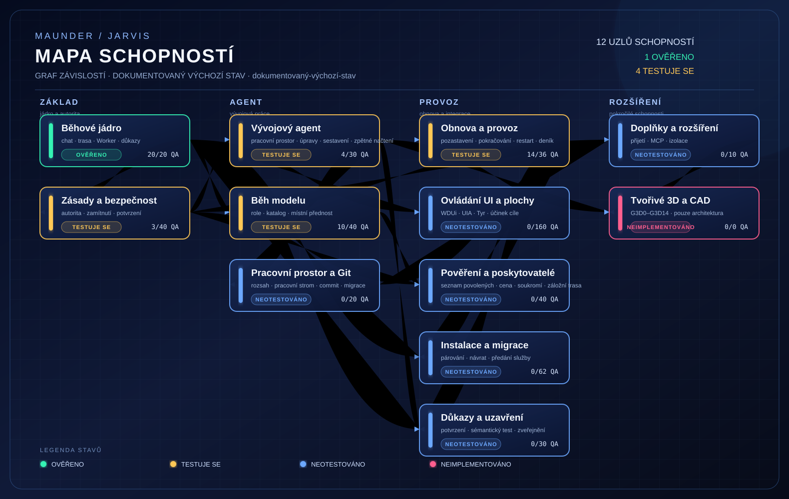

# Project codename: Jarvis

**Jazyk / Language:** **Čeština (výchozí)** · [English fallback](README.en.md)

<p><a href="README.en.md">🇬🇧 <strong>Open English fallback</strong></a></p>

**Jarvis je interní codename projektu ve vývoji, nikoli finální produktový název.**

Cílem je bezplatná edice **Personal 1.0.0**. Až bude připravená k veřejnému vydání, bude zde zveřejněna pod jiným produktovým názvem.

Aktuálně zde není žádný veřejný instalační balíček ke stažení. Dřívější vývojové a beta buildy byly z aktuálního download kanálu odstraněny, protože neodpovídají cílové kvalitě a rozsahu verze 1.0.0.

## Zpětná vazba / Feedback

Jarvis je veřejně sledovaný vývojový projekt. Pro zpětnou vazbu použij prosím jednu z těchto cest:

- [🐞 Nahlásit chybu / Report a bug](https://github.com/jeniksoft/app-downloads/issues/new?template=bug_report.yml)
- [💡 Navrhnout zlepšení / Suggest an improvement](https://github.com/jeniksoft/app-downloads/issues/new?template=feature_request.yml)
- [💬 Otevřít diskuzi / Start a discussion](https://github.com/jeniksoft/app-downloads/discussions)

Do veřejných příspěvků nevkládej hesla, tokeny, osobní údaje ani celé soukromé logy. Přikládej pouze očištěné a nezbytné informace.

## Věkové omezení / Age restriction (18+)

**CZ:** Jarvis je určen výhradně dospělým uživatelům od 18 let. Pokud ti ještě nebylo 18 let, Jarvis nepoužívej.

**EN:** Jarvis is intended exclusively for adults aged 18 and over. If you are under 18, do not use Jarvis.

<!-- JARVIS_IMPLEMENTATION_PROGRESS_BEGIN -->
## Jarvis Personal: stav implementace z roadmapy

**796 / 951 = 83.70 % s implementační evidencí**

Všechny vrcholové i vnořené řezy mají stejnou váhu. Implementační evidence počítá stavy verified, implemented-unverified a release-ready; implemented-unverified není ověření ani release acceptance. Staré vážené evidenční přehledy se nezobrazují.

| Roadmapová skupina | S implementační evidencí / celkem |
| --- | ---: |
| Platformní základy | 55 / 55 |
| Jádro runtime | 64 / 64 |
| Personal 1.0.0 | 144 / 149 |
| Volitelné tratě | 138 / 166 |
| Teams | 70 / 70 |
| Enterprise | 63 / 63 |
| Průřezové capability tratě | 262 / 384 |

Stav: 499 verified, 297 implemented-unverified, 0 release-ready, 4 in-progress, 149 architecture-only, 2 deferred.

Toto číslo NENÍ produkční připravenost, živé QA ani release akceptace. [Detailní snapshot](progress.json) může obsahovat historická QA pole s jinou metodikou.

<!-- JARVIS_IMPLEMENTATION_PROGRESS_END -->

<!-- JARVIS_CAPABILITY_MAP_BEGIN -->
## Mapa schopností: sci-fi constellation



Mapa je graf schopností a závislostí, ne seznam intervalů scénářů. Každý uzel
ukazuje implementační stav, QA stav a počet přidružených scénářů; šipky vedou od
nutných předpokladů k navazující schopnosti.

**Snapshot:** doloženého baseline · zdrojová revize `documented-basel` ·
12 capability uzlů

| Stav | Uzly |
| --- | ---: |
| Ověřeno | 1 |
| Testuje Se | 4 |
| Neotestováno | 6 |
| Neimplementováno | 1 |

`TESTED` znamená evidence-bound PASS, nikoli release akceptaci. `TESTING` je
částečně doložená nebo právě ověřovaná schopnost. `NOT_TESTED` nemá aktuální
QA důkaz a `NOT_IMPLEMENTED` zůstává architecture-only. Graf záměrně ukazuje
i závislosti na schopnostech, které ještě nejsou implementované.

### Aktualizace bez GitHub Actions

Mapa se aktualizuje lokálně ze scénářového runtime. Z kořene CPM nejprve
vyexportuj sanitizované inventory (bez promptů, tajemství a raw výstupů), potom
spusť generátor v tomto repozitáři:

```powershell
python tools/jarvis/tools/scenario_pyramid_runtime.py --repo-root Z:\Codex\CPM --state Z:\Codex\CPM\qa\scenario-state.json inventory > E:\app-downloads\apps\jarvis\scenario-inventory.json
python tools/generate_jarvis_capability_map.py --inventory apps/jarvis/scenario-inventory.json
```

Generátor je deterministický a mění pouze `capability-status.json`, SVG mapu a
tuto označenou README sekci. Neexistuje workflow, placený runner ani síťové
volání; změna se publikuje běžným chráněným PR.
<!-- JARVIS_CAPABILITY_MAP_END -->

## Co se připravuje

Personal 1.0.0 má být local-first osobní agent pro Windows, který může používat lokální modely, modely v LAN i uživatelem zvoleného providera a nemá vyžadovat povinný Jeniksoft inference cloud ani Jeniksoft tokenové platby.

Vývoj se nyní soustředí především na spolehlivost, recovery, bezpečnost akcí, práci s evidencí a zdroji, memory, support/reprodukci chyb, supervised self-development, instalaci/rollback a ověření na různých skutečných počítačích.

## Dostupnost

Veřejné datum vydání zatím není stanoveno. Verze 1.0.0 bude zveřejněna až po splnění release gates; samotný počet implementovaných funkcí není důvodem označit build za hotový.
