# Project codename: Jarvis

**Jarvis je interní codename projektu ve vývoji, nikoli finální produktový název.**

Cílem je bezplatná edice **Personal 1.0.0**. Až bude připravená k veřejnému vydání, bude zde zveřejněna pod jiným produktovým názvem.

Aktuálně zde není žádný veřejný instalační balíček ke stažení. Dřívější vývojové a beta buildy byly z aktuálního download kanálu odstraněny, protože neodpovídají cílové kvalitě a rozsahu verze 1.0.0.

## Zpětná vazba / Feedback

Jarvis je veřejně sledovaný vývojový projekt. Pro zpětnou vazbu použij prosím jednu z těchto cest:

- [🐞 Nahlásit chybu / Report a bug](https://github.com/jeniksoft/app-downloads/issues/new?template=bug_report.yml)
- [💡 Navrhnout zlepšení / Suggest an improvement](https://github.com/jeniksoft/app-downloads/issues/new?template=feature_request.yml)
- [💬 Otevřít diskuzi / Start a discussion](https://github.com/jeniksoft/app-downloads/discussions)

Do veřejných příspěvků nevkládej hesla, tokeny, osobní údaje ani celé soukromé logy. Přikládej pouze očištěné a nezbytné informace.

## Věkové omezení / Age restriction (18+)

**CZ:** Jarvis je určen výhradně dospělým uživatelům od 18 let. Pokud ti ještě nebylo 18 let, Jarvis nepoužívej.

**EN:** Jarvis is intended exclusively for adults aged 18 and over. If you are under 18, do not use Jarvis.

<!-- JARVIS_IMPLEMENTATION_PROGRESS_BEGIN -->
## Sledování implementace Personal 1.0.0

**Synchronizovaný snapshot: 2026-10-12**

Implementační pokrytí roadmapy je **96.86 %** z kanonických řezů. Souhrn níže ukazuje Ověřeno, kumulativní Implementováno včetně Ověřeno, Rozpracováno a Architekturu.

**Jazyk reportu:** čeština pro `cs*`; jiné locale používá anglický fallback. GitHub README je statický a jazyk se určuje při generování.

### Souhrn metrik

| Metrika | Hodnota | Zdroj a význam |
| --- | ---: | --- |
| `implementation_complete_percent` | 96.86 % | Kanonické implementační pokrytí roadmapových řezů. |
| `roadmap_verified_percent` | 57.14 % | Podíl kanonických řezů ve stavu Ověřeno. |
| `roadmap_implemented_percent` | 96.83 % | Kumulativní podíl kanonických řezů implementovaných včetně ověřených; vždy je větší nebo roven Ověřeno. |
| `roadmap_in_progress_percent` | 0.13 % | Podíl kanonických řezů ve stavu Rozpracováno. |
| `roadmap_architecture_percent` | 3.04 % | Podíl kanonických řezů ve stavu Architektura. |

### Jarvis report

Tato stránka ukazuje kanonické implementační pokrytí roadmapy (96.86 %), stav každého řezu a jeho skutečný vývoj v čase.
Nejde o instalační balíček ani o prohlášení, že je produkt hotový; připravenost vydání je samostatná roadmapová brána.

### Grafický dashboard

Čísla jsou záměrně kreslená přímo na sloupcích, bodech, uzlech a tilech. Každý řez má v roadmapě i historii deterministický pás starší → novější; pořadí, ID a Unknown fallback určuje runtime, ne modelová paměť. Tabulky níže ukazují kanonický stav, implementaci a změny řezů.

### Kanonický stav roadmapových skupin

Tato tabulka používá stejné kanonické řezy jako roadmapa a historie; při změně stavu řezu se změní příslušný řádek i souhrnný graf.

| Roadmapová skupina | Řezy | Implementace | Ověřeno | Implementováno včetně ověřených | Rozpracováno | Architektura |
| --- | ---: | ---: | ---: | ---: | ---: | ---: |
| Platformní základy | 54 | 100.00 % | 100.00 % | 100.00 % | 0.00 % | 0.00 % |
| Jádro runtime | 57 | 100.00 % | 57.89 % | 100.00 % | 0.00 % | 0.00 % |
| Personal 1.0.0 | 127 | 99.41 % | 98.43 % | 99.21 % | 0.79 % | 0.00 % |
| Volitelné tratě | 132 | 100.00 % | 75.76 % | 100.00 % | 0.00 % | 0.00 % |
| Teams | 70 | 100.00 % | 20.00 % | 100.00 % | 0.00 % | 0.00 % |
| Enterprise | 63 | 100.00 % | 14.29 % | 100.00 % | 0.00 % | 0.00 % |
| Průřezové capability tratě | 253 | 90.91 % | 38.34 % | 90.91 % | 0.00 % | 9.09 % |

### Roadmapa produktu

**Legenda ikon:** · ✅ Ověřeno · 🟦 Implementováno · 🟠 Rozpracováno · ⚪ Architektura · ⛔ Blokováno
Implementováno je kumulativní stav a zahrnuje všechny ověřené řezy; Ověřeno je jeho podmnožina. Rozpracováno a Architektura zůstávají samostatné kanonické stavy. Disjunktní raw počty jsou pouze ve strojovém JSON.
Ikona i popisek jsou viditelné přímo v README; po najetí kurzorem tooltip vysvětlí význam a nezaměňuje implementaci za živé ověření.

**Změna od předchozího snapshotu: roadmapa položky +0 · implementováno +0**

Všechny podřezy a karty edic jsou v grafu výše; duplicitní textové tabulky se nezobrazují. Přesná strojová data zůstávají v přiloženém JSON snapshotu.

### Release gates

| Stav | Edice | Stručný popis | Ověření | Závislosti |
| --- | --- | --- | --- | ---: |
| 🟠 Rozpracováno | `personal-1.0.0` | Bezplatný local-first Jarvis pro jednoho člověka. | `V6` | 9 |
| 🟦 Otevřeno | `teams` | Spolupráce v jednom zákaznicky vlastněném TeamRealmu. | `V6` | 12 |
| 🟦 Otevřeno | `enterprise` | Rekurzivní zákaznicky vlastněná organizace a Konstelace. | `V6` | 10 |

Personal, Teams i Enterprise zde používají kanonickou roadmapu; edice bez aktivního průběhu nezobrazují falešnou nulu.

### MAUNDER: audioknihy a CPU/GPU (automatický stav)

Tento přehled se generuje automaticky ze strojové roadmapy, bez modelového rozhodování. Stav `verified` u starších OP3 řeší jen výslovně uvedený dílčí kontrakt; neznamená hotovou audioknihu, GPU hlas ani schválenou kvalitu přednesu. Zde uvedené nové řezy mají vlastní kanonický stav a historii.

| Úkol | Stav | Požadovaná práce |
| --- | --- | --- |
| `AUDN0` (`OP3.10.0`) | `implemented-unverified` | Fresh audit OP3.1–3.9, současného Piper runtime, text preparation, OP3.6/3.7, Worker/Policy, CPU dostupnosti, všech reálně možných GPU TTS backendů (AMD/NVIDIA) |
| `AUDN1` (`OP3.10.1`) | `verified` | Provider-free typovaný LongFormSpeechJob s identitou ownera a zdroje, jazykem, providerem, hlasovým profilem, rozsahem, formátem, resource budgetem a persistovaný... |
| `AUDN2` (`OP3.10.2`) | `implemented-unverified` | Owner-authorized import/export s bezpečným výběrem souboru a scope. TXT/Markdown first; PDF/DOCX/EPUB jen s legitimním extractor adaptérem. Kontrola významových |
| `AUDN3` (`OP3.10.3`) | `implemented-unverified` | Normalizace do mluveného češtiny, oddíly/kapitoly, výslovnostní profily, zlomky, čísla a transparentní přepis. Segmenter bez ztracených/zdvojených vět. |
| `AUDN4` (`OP3.10.4`) | `implemented-unverified` | Hlasový picker, explicitní volba Automaticky/CPU/Preferovat GPU/Pouze GPU s per-model dostupností a 20–60s lokální preview přes existující ověřený Piper; audit sk... |
| `AUDN5` (`OP3.10.5`) | `implemented-unverified` | Zabezpečené batch synthesis ve vlastní job scope (nikoliv notifikační fronta), skutečné WAV části, explicitní CPU i ověřenou GPU routing policy podle podpory back... |
| `AUDN6` (`OP3.10.6`) | `implemented-unverified` | Dlouhé dokumenty, evidence cache včetně backend/device/runtime identity, checkpoint+resume, atomický output commit, idempotentní opakování, oprava konkrétního vad... |
| `AUDN7` (`OP3.10.7`) | `implemented-unverified` | Lokální spojení se správnými pauzami, konzistentní úroveň a finální MP3/WAV přes prověřený FFmpeg/encoder; `ffprobe`, SHA-256, duration, chybovost a real file r |
| `AUDN8` (`OP3.10.8`) | `implemented-unverified` | V hlavním WDUi/Skalda UI kontextové „Vytvořit MP3 / audioknihu“, dialog parametrů s přehlednou volbou Auto/CPU/Preferovat GPU/Pouze GPU, dostupnými zařízeními a |
| `AUDN9` (`OP3.10.9`) | `implemented-unverified` | Kvalitativní poslechový gate OP3.7: české názvy, tempo, intonace a návaznosti; oddělit automatickou validitu souboru od lidské srozumitelnosti. |
| `AUDN10` (`OP3.10.10`) | `implemented-unverified` | Volitelný další lokální Czech TTS provider, např. Chatterbox pouze po licenčním a gated-download souhlasu, sandboxu, zvláštním benchmarku CPU a kompatibilního GPU... |
| `AUDN11` (`OP3.10.11`) | `implemented-unverified` | Datově uložené formátové presety („Technický výklad“, „Audiokniha“, „Krátké shrnutí“), oprávněný CLI/API/skills entry point a jazyky pouze s přesným profilem z re... |
| `AUDN12` (`OP3.10.12`) | `implemented-unverified` | Long-form/offline QA na reálné české nahrávce včetně restartu, privacy audit, volby a skutečné inference CPU/GPU na podporovaných modelech, negative fallback test... |
| `AUDR0` (`OP3.11.0`) | `implemented-unverified` | Source-matched audit současných P2.10, PF4.5, OP3.5/3.6/3.7, Worker/cancel, procesových hranic a CPU/GPU backend matrix bez falešné deklarace TTS GPU. |
| `AUDR1` (`OP3.11.1`) | `implemented-unverified` | Provider-neutral bounded hardware capability, memory estimate, CPU/GPU/Auto/GPU-only request, typed decision and provenance without false GPU readiness. |
| `AUDR2` (`OP3.11.2`) | `implemented-unverified` | TTS admission do existující P2.10 GPU resource owner bez druhého governoru; simulovaný Ollama+TTS GPU souběh drží jedinou lease a má bounded timeout/cancel/release. |
| `AUDR3` (`OP3.11.3`) | `implemented-unverified` | Omezený CPU TTS/encoding worker pool a RAM/VRAM host budget s prioritami ostatních úloh. \| CPU audio + GPU model skutečně probíhají současně bez vyhladovění hla |
| `AUDR4` (`OP3.11.4`) | `implemented-unverified` | Provider-free čekání, priority, aging/fair queue a host-controlled admission mezi speech chunky přes existing Worker lifecycle. \| Deterministické race testy, boun... |
| `AUDR5` (`OP3.11.5`) | `implemented-unverified` | Restart/cancel/cross-backend checkpoint evidence + soukromý izolovaný chunk cache. \| Kill/restart mezi chunky, dokončení přesně jednou a oddělení workspace/tena |
| `AUDR6` (`OP3.11.6`) | `implemented-unverified` | Přehled vytížení CPU/GPU/RAM/VRAM, režim Auto/CPU/Prefer GPU/GPU only, status a owner preference přímo ve stávajícím UI. \| UI read-back identické s host admissi |
| `AUDR7` (`OP3.11.7`) | `implemented-unverified` | Reálný 15-25min český MP3 dogfood a concurrent workload měření včetně času syntézy i audio QA. \| Jedna ověřená offline MP3; skutečná současná interaktivní infer |
| `AUDR8` (`OP3.11.8`) | `implemented-unverified` | Po samostatném reálném GPU TTS backend probe optimalizace GPU speech a případně bezpečná multi-GPU admission. \| Doklad skutečné GPU allocation, memory residency |
| `AUDR9` (`OP3.11.9`) | `implemented-unverified` | Zátěžové testy restart, zaplnění VRAM, memory pressure, dlouhá práce, power-saving, tenant isolation, licence a release gates. \| Nezávisle ověřené V0–V6/PG1 relev... |

Architektura se nezapočítává jako hotová implementace. Přesný stav, implementační hodnota a historie každého řezu jsou v [progress.json](progress.json).

### Zdrojový inventář Jarvise

Rozsah `tools/jarvis` je čtený z `git archive HEAD`; fyzické řádky zahrnují i prázdné a komentářové řádky. Velikost je uvedená v desítkových MB (1 MB = 1 000 000 bajtů).

| Jazyk / obsah | Soubory | Fyzické řádky | Velikost (MB) |
| --- | ---: | ---: | ---: |
| C/C++ | 2 409 | 753 370 | 36.39 |
| JSON | 580 | 200 769 | 33.21 |
| Markdown | 1 143 | 158 024 | 8.78 |
| Python | 795 | 128 870 | 5.38 |
| PowerShell | 73 | 34 697 | 1.82 |
| Other text | 81 | 5 975 | 0.30 |
| JSONL | 16 | 2 515 | 6.93 |
| Plain text | 130 | 1 815 | 0.19 |
| INI | 8 | 703 | 0.04 |
| Shell | 2 | 501 | 0.02 |
| CMake | 2 | 154 | 0.01 |
| YAML | 3 | 16 | 0.00 |
| Encoded text | 13 | 13 | 0.06 |
| Nanity pseudocode | 2 | 13 | 0.00 |
| **Text/source celkem** | **5 257** | **1 287 435** | **93.12** |
| Binární assety (mimo řádky) | 41 | — | 14.68 |
| **Trackovaný strom celkem** | **5 298** | **1 287 435** | **107.80** |

### Přírůstek od předchozí revize

Delta je vůči předchozímu commitnutému snapshotu (`HEAD^`); kladná hodnota znamená přírůstek a záporná úbytek. U prvního commitu je baseline nedostupná.

| Oblast | Δ soubory | Δ fyzické řádky | Δ velikost (MB) |
| --- | ---: | ---: | ---: |
| Text/source celkem | +0 | +0 | +0.00 |
| Binární assety | +0 | — | +0.00 |
| Trackovaný strom celkem | +0 | +0 | +0.00 |

Binární assety jsou uvedené zvlášť, aby nebyly zaměněné za programovací jazyk. Tento inventář je informativní a nemění žádné procento dokončení, ověření, hotova ani release readiness.

### Kanonické kapitoly

| Kanonická kapitola | Řezy | Implementace | Ověřeno | Implementováno včetně ověřených | Rozpracováno | Architektura |
| --- | ---: | ---: | ---: | ---: | ---: | ---: |
| PF0 — Stable identities and namespaces | 4 | 100.00 % | 100.00 % | 100.00 % | 0.00 % | 0.00 % |
| PF1 — Schémata, persistence a migrace | 6 | 100.00 % | 100.00 % | 100.00 % | 0.00 % | 0.00 % |
| PF2 — Time epochs and leases | 6 | 100.00 % | 100.00 % | 100.00 % | 0.00 % | 0.00 % |
| PF3 — Secrets and credential boundary | 14 | 100.00 % | 100.00 % | 100.00 % | 0.00 % | 0.00 % |
| PF4 — Resource budgets cancellation and cleanup | 5 | 100.00 % | 100.00 % | 100.00 % | 0.00 % | 0.00 % |
| PF5 — Artifact evidence and provenance | 5 | 100.00 % | 100.00 % | 100.00 % | 0.00 % | 0.00 % |
| PF6 — Capability health degraded and quarantine states | 5 | 100.00 % | 100.00 % | 100.00 % | 0.00 % | 0.00 % |
| PF7 — Configuration ownership precedence and portability | 5 | 100.00 % | 100.00 % | 100.00 % | 0.00 % | 0.00 % |
| PF8 — Architecture Self-Model integration | 4 | 100.00 % | 100.00 % | 100.00 % | 0.00 % | 0.00 % |
| C0 — Polaris durable owner goal authority | 7 | 100.00 % | 0.00 % | 100.00 % | 0.00 % | 0.00 % |
| C1 — Ariadna Hydra Norn Nanity Mimir execution control plane | 10 | 100.00 % | 0.00 % | 100.00 % | 0.00 % | 0.00 % |
| C2 — Kormidlo benchmark Work Report and deployment decision | 8 | 100.00 % | 100.00 % | 100.00 % | 0.00 % | 0.00 % |
| C3 — Typed executor scope source authority and structured edit boundary | 10 | 100.00 % | 100.00 % | 100.00 % | 0.00 % | 0.00 % |
| C4 — Pulse and Saga truthful owner observability | 8 | 100.00 % | 100.00 % | 100.00 % | 0.00 % | 0.00 % |
| C5 — Independent Aegis verification and acceptance authority | 7 | 100.00 % | 0.00 % | 100.00 % | 0.00 % | 0.00 % |
| C6 — CoreService Bifrost and typed same-user process boundary | 7 | 100.00 % | 100.00 % | 100.00 % | 0.00 % | 0.00 % |
| P1 — Recovery and durable execution | 11 | 100.00 % | 100.00 % | 100.00 % | 0.00 % | 0.00 % |
| P2 — Model and provider reliability | 12 | 100.00 % | 100.00 % | 100.00 % | 0.00 % | 0.00 % |
| P3 — Intake Research and source quality | 11 | 100.00 % | 100.00 % | 100.00 % | 0.00 % | 0.00 % |
| P4 — Workspace action reliability | 16 | 100.00 % | 100.00 % | 100.00 % | 0.00 % | 0.00 % |
| P5 — Memory and continuity | 20 | 100.00 % | 100.00 % | 100.00 % | 0.00 % | 0.00 % |
| P6 — Secure Support Ticket | 11 | 100.00 % | 100.00 % | 100.00 % | 0.00 % | 0.00 % |
| P7 — Supervised self development | 11 | 100.00 % | 90.91 % | 100.00 % | 0.00 % | 0.00 % |
| P8 — Owner UX observability and release QA | 30 | 97.50 % | 96.67 % | 96.67 % | 3.33 % | 0.00 % |
| P9 — Real world configuration matrix | 5 | 100.00 % | 100.00 % | 100.00 % | 0.00 % | 0.00 % |
| OP1 — Hermes local facade | 13 | 100.00 % | 84.62 % | 100.00 % | 0.00 % | 0.00 % |
| OP2 — Image generation | 6 | 100.00 % | 66.67 % | 100.00 % | 0.00 % | 0.00 % |
| OP3 — TTS STT audio | 38 | 100.00 % | 36.84 % | 100.00 % | 0.00 % | 0.00 % |
| OP4 — Ambient Presence Voice Mesh | 32 | 100.00 % | 93.75 % | 100.00 % | 0.00 % | 0.00 % |
| OP5 — Repair Capsules | 8 | 100.00 % | 100.00 % | 100.00 % | 0.00 % | 0.00 % |
| OP6 — Architecture Self Model | 8 | 100.00 % | 100.00 % | 100.00 % | 0.00 % | 0.00 % |
| OP7 — Tyr isolated computer control | 10 | 100.00 % | 80.00 % | 100.00 % | 0.00 % | 0.00 % |
| OP8 — Defensive Security Lab | 8 | 100.00 % | 100.00 % | 100.00 % | 0.00 % | 0.00 % |
| OP9 — Research tutoring Strata Trace | 9 | 100.00 % | 100.00 % | 100.00 % | 0.00 % | 0.00 % |
| TR0 — Realm identity and local topology | 4 | 100.00 % | 100.00 % | 100.00 % | 0.00 % | 0.00 % |
| TR1 — Principals devices membership | 5 | 100.00 % | 100.00 % | 100.00 % | 0.00 % | 0.00 % |
| TR2 — Roles capabilities policy | 5 | 100.00 % | 100.00 % | 100.00 % | 0.00 % | 0.00 % |
| TR3 — Shared project registry | 6 | 100.00 % | 0.00 % | 100.00 % | 0.00 % | 0.00 % |
| TR4 — Realm event log and offline sync | 6 | 100.00 % | 0.00 % | 100.00 % | 0.00 % | 0.00 % |
| TR5 — Shared Global Memory | 7 | 100.00 % | 0.00 % | 100.00 % | 0.00 % | 0.00 % |
| TR6 — Shared skills pipelines model profiles | 6 | 100.00 % | 0.00 % | 100.00 % | 0.00 % | 0.00 % |
| TR7 — Approvals collaborative workflows | 6 | 100.00 % | 0.00 % | 100.00 % | 0.00 % | 0.00 % |
| TR8 — Customer hosted LAN transport | 7 | 100.00 % | 0.00 % | 100.00 % | 0.00 % | 0.00 % |
| TR9 — Backup recovery admin audit | 8 | 100.00 % | 0.00 % | 100.00 % | 0.00 % | 0.00 % |
| TR10 — Offline licensing expiry release | 10 | 100.00 % | 0.00 % | 100.00 % | 0.00 % | 0.00 % |
| RC0 — Recursive topology foundation | 6 | 100.00 % | 100.00 % | 100.00 % | 0.00 % | 0.00 % |
| RC1 — Delegated policy and authority | 7 | 100.00 % | 42.86 % | 100.00 % | 0.00 % | 0.00 % |
| RC2 — Recursive memory and data scopes | 6 | 100.00 % | 0.00 % | 100.00 % | 0.00 % | 0.00 % |
| RC3 — Hierarchical capability aggregation and scheduling | 7 | 100.00 % | 0.00 % | 100.00 % | 0.00 % | 0.00 % |
| RC4 — Explicit cross-scope compute artifacts collaboration | 6 | 100.00 % | 0.00 % | 100.00 % | 0.00 % | 0.00 % |
| RC5 — Offline subtree autonomy | 6 | 100.00 % | 0.00 % | 100.00 % | 0.00 % | 0.00 % |
| RC6 — Reconciliation hostile partition partial reintegration | 7 | 100.00 % | 0.00 % | 100.00 % | 0.00 % | 0.00 % |
| RC7 — Scale administration operability | 8 | 100.00 % | 0.00 % | 100.00 % | 0.00 % | 0.00 % |
| RC8 — Enterprise licensing migration release acceptance | 10 | 100.00 % | 0.00 % | 100.00 % | 0.00 % | 0.00 % |
| B — Browser and AI browser | 8 | 100.00 % | 50.00 % | 100.00 % | 0.00 % | 0.00 % |
| LIC — License liability and EULA | 7 | 100.00 % | 0.00 % | 100.00 % | 0.00 % | 0.00 % |
| AG — Adaptive user guidance | 9 | 100.00 % | 88.89 % | 100.00 % | 0.00 % | 0.00 % |
| ASA — Adversarial security audit | 13 | 100.00 % | 61.54 % | 100.00 % | 0.00 % | 0.00 % |
| ECM — Execution continuity and maintenance | 15 | 100.00 % | 46.67 % | 100.00 % | 0.00 % | 0.00 % |
| IG — Image generation capability | 6 | 100.00 % | 66.67 % | 100.00 % | 0.00 % | 0.00 % |
| LM0 — Architecture/source inventory and contract map | 7 | 100.00 % | 100.00 % | 100.00 % | 0.00 % | 0.00 % |
| LM1 — Module contracts Module Host and Capability Registry | 10 | 100.00 % | 100.00 % | 100.00 % | 0.00 % | 0.00 % |
| LM2 — Observation Bus normalized evidence input and source adapters | 13 | 100.00 % | 100.00 % | 100.00 % | 0.00 % | 0.00 % |
| LM3 — Evidence Fusion and Local World Situation Model | 10 | 100.00 % | 100.00 % | 100.00 % | 0.00 % | 0.00 % |
| LM4 — Significance Evaluator and Attention Scheduler | 10 | 100.00 % | 0.00 % | 100.00 % | 0.00 % | 0.00 % |
| LM5 — Persistent autonomous loop and bounded self-generated work | 25 | 100.00 % | 36.00 % | 100.00 % | 0.00 % | 0.00 % |
| LM6 — Inter-Jarvis Protocol and Capability Federation | 10 | 100.00 % | 0.00 % | 100.00 % | 0.00 % | 0.00 % |
| LM7 — Federated Situation Projections and Global Memory bridge | 10 | 100.00 % | 0.00 % | 100.00 % | 0.00 % | 0.00 % |
| LM8 — Physical sensors machines and robot safety adapters | 10 | 100.00 % | 0.00 % | 100.00 % | 0.00 % | 0.00 % |
| LM9 — Hierarchical Constellation attention delegation and reintegration | 10 | 100.00 % | 0.00 % | 100.00 % | 0.00 % | 0.00 % |
| MS — Model Space 3D | 8 | 100.00 % | 12.50 % | 100.00 % | 0.00 % | 0.00 % |
| PORT — Platform independence | 16 | 100.00 % | 6.25 % | 100.00 % | 0.00 % | 0.00 % |
| VG — Video generation capability | 8 | 100.00 % | 0.00 % | 100.00 % | 0.00 % | 0.00 % |
| LN — Language-neutral intent and multilingual interaction | 9 | 100.00 % | 88.89 % | 100.00 % | 0.00 % | 0.00 % |
| MDOC — Complete versioned documentation available to models | 7 | 100.00 % | 42.86 % | 100.00 % | 0.00 % | 0.00 % |
| MUI — Model-guided Jarvis UI navigation and visual spotlight | 9 | 100.00 % | 44.44 % | 100.00 % | 0.00 % | 0.00 % |
| SRH — Incident-triggered service recovery and support handoff | 9 | 0.00 % | 0.00 % | 0.00 % | 0.00 % | 100.00 % |
| PAC — Pre-authorized post-task autonomous follow-up | 14 | 0.00 % | 0.00 % | 0.00 % | 0.00 % | 100.00 % |

Tato tabulka je odvozena z kanonických řezů roadmapy; změna řezu mění odpovídající řádek i podíly stavů.

### Vývoj v relevantních revizích

Každý bod a změnová anotace jsou v časovém grafu historie; tabulka uvádí přírůstky všech hlavních metrik oproti předchozímu bodu a každý anonymizovaný záznam zůstává i ve strojově čitelném JSON. Raw private source commit, subject ani interní cesta se do veřejného repa nekopírují; přesný identifikátor posledního closeoutu je pouze v samostatném ověřovacím obalu.

| Veřejná revize | Datum | Δ implementace roadmapy | Δ ověřené řezy | Δ implementované řezy včetně ověřených | Δ rozpracované řezy | Δ architektura | Změněné řezy |
| --- | --- | ---: | ---: | ---: | ---: | ---: | --- |
| `052b6d5b9af8` | 2026-10-12 | +0.00 | +0.00 | +0.00 | +0.00 | +0.00 | — |
| `d985b80d106a` | 2026-10-12 | +0.00 | +0.40 | +0.00 | +0.00 | +0.00 | 3: MDOC0, MDOC1, MDOC2 |
| `17e03b13df8b` | 2026-10-12 | +0.00 | +0.00 | +0.00 | +0.00 | +0.00 | — |
| `0046ad766a2b` | 2026-10-12 | +0.00 | +0.52 | +0.00 | +0.00 | +0.00 | 4: MUI0, MUI1, MUI2, MUI3 |
| `ed07335d8b3e` | 2026-10-12 | +0.00 | +0.00 | +0.00 | +0.00 | +0.00 | — |
| `70117824f424` | 2026-10-12 | +0.00 | +1.72 | +0.00 | +0.00 | +0.00 | 13: LM2.1, LM2.10, LM2.11, LM2.12, LM2.13, LM2.2… |
| `8a3382ecd274` | 2026-10-12 | +0.00 | +0.00 | +0.00 | +0.00 | +0.00 | — |
| `cbfaf1fddd96` | 2026-10-12 | +0.00 | +1.33 | +0.00 | +0.00 | +0.00 | 10: LM3.1, LM3.10, LM3.2, LM3.3, LM3.4, LM3.5… |
| `d34ab32de3f1` | 2026-10-12 | +0.00 | +0.00 | +0.00 | +0.00 | +0.00 | — |
| `7f762dd7e8d2` | 2026-10-12 | +0.00 | +0.53 | +0.00 | +0.00 | +0.00 | 4: LM5.13, LM5.14, LM5.15, LM5.17 |
| `881daf1f391a` | 2026-10-12 | +0.00 | +0.00 | +0.00 | +0.00 | +0.00 | — |
| `52c86931d241` | 2026-10-12 | +0.00 | +0.39 | +0.00 | +0.00 | +0.00 | 3: B1, B2, B3 |
| `2a69c084e020` | 2026-10-12 | -3.18 | -12.30 | -3.18 | +0.00 | +3.18 | 110: AG3, AG4, AG5, AG6, AG7, B1… |
| `cf2e5aeaa554` | 2026-10-12 | +3.18 | +12.30 | +3.18 | +0.00 | -3.18 | 110: AG3, AG4, AG5, AG6, AG7, B1… |
| `5a826a445d9d` | 2026-10-12 | +0.00 | +0.00 | +0.00 | +0.00 | +0.00 | — |
| `248caa34a542` | 2026-10-12 | +0.00 | +0.00 | +0.00 | +0.00 | +0.00 | — |
| `e32710ef81ef` | 2026-10-12 | +0.00 | +0.00 | +0.00 | +0.00 | +0.00 | — |
| `3accc1584a93` | 2026-10-12 | +0.00 | +0.00 | +0.00 | +0.00 | +0.00 | — |

Úplná strojově čitelná historie: [progress-history.json](progress-history.json). Snapshot: [progress.json](progress.json).

### Úspora GitHub Actions

Historický baseline: starý režim by spustil **64** běhů, closeout režim **63**; odhadovaná úspora je **1** běhů (**1.56 %**).
Optimalizace běhu: 0 inkrementálních closeout bodů od posledního úplného baseline, žádný klon `app-downloads`, žádný úplný průchod soukromou historií a nejvýše jeden veřejný commit; bajtově se publikují jen změněné JSON, README, historické a SVG artefakty.
Historický baseline je oddělený od aktuálního inkrementálního výpočtu, aby se úspora nepředstírala z neúplné mělké historie.

### Release readiness

| Release oblast | Stav |
| --- | --- |
| Recovery a durable execution | `partial` |
| Model/provider spolehlivost | `advanced` |
| Intake, research a source quality | `partial` |
| Workspace a bezpečné akce | `advanced` |
| Memory a continuity | `advanced` |
| Secure Support Ticket | `early` |
| Supervised self-development | `early` |
| UX, installer, update a release QA | `partial` |
| Reálný hardware/configuration matrix | `early` |

### Měřicí kontrakt

- `implementation_complete_percent`: jediná veřejná implementační hodnota; deterministické kanonické pokrytí všech roadmapových řezů.
- `roadmap_verified_percent`: podíl kanonických řezů ve stavu Ověřeno.
- `roadmap_implemented_percent`: kumulativní podíl kanonických řezů ve stavu Implementováno včetně Ověřeno; vždy je větší nebo roven Ověřeno.
- `roadmap_in_progress_percent` a `roadmap_architecture_percent`: samostatné disjunktní raw stavy roadmapy.
- `history`: každá revize obsahuje změněné kanonické řezy a bounded historický pás podle jejich stabilních ID.
- `Task Board`: slouží k mapování kapitol a synchronizaci podpůrných dat; neřídí veřejné implementační procento.
- Starší interní pole zůstávají pouze ve strojovém JSON kvůli kompatibilitě; veřejné tabulky a grafy je nepoužívají jako implementaci.
<!-- JARVIS_IMPLEMENTATION_PROGRESS_END -->

## Co se připravuje

Personal 1.0.0 má být local-first osobní agent pro Windows, který může používat lokální modely, modely v LAN i uživatelem zvoleného providera a nemá vyžadovat povinný Jeniksoft inference cloud ani Jeniksoft tokenové platby.

Vývoj se nyní soustředí především na spolehlivost, recovery, bezpečnost akcí, práci s evidencí a zdroji, memory, support/reprodukci chyb, supervised self-development, instalaci/rollback a ověření na různých skutečných počítačích.

## Dostupnost

Veřejné datum vydání zatím není stanoveno. Verze 1.0.0 bude zveřejněna až po splnění release gates; samotný počet implementovaných funkcí není důvodem označit build za hotový.
